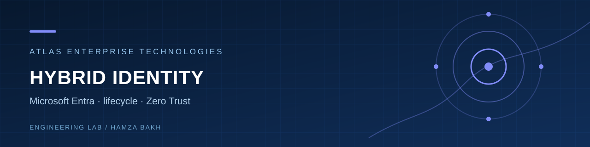
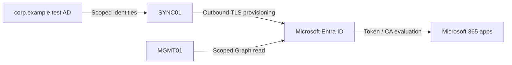

# Hybrid Identity, Microsoft Entra and Zero Trust Lab

**Atlas Enterprise Technologies · Hamza Bakh · Identity Security portfolio**

> **IMPLEMENTED/TESTED:** offline synthetic JML planner and tests. **DOCUMENTED ONLY:** Entra Connect/Cloud Sync, SSO, MFA, Conditional Access, Graph and incident procedures. **SIMULATED:** transition plans. **BLOCKED:** tenant synchronization, sign-ins, license-dependent controls and authentic tenant screenshots.

## Project overview and business problem

The fictional enterprise needs consistent employee lifecycle control across on-premises AD and Microsoft Entra ID without losing emergency access or visibility. This repository models changes locally, includes [200 matching synthetic identities](examples/synthetic-data/identities-200.csv), and defines a safe tenant rollout; it has not changed an AD forest or Entra tenant.

## Engineering objectives

Design scoped synchronization, choose an authentication method, stage MFA/Conditional Access safely, govern privileged roles, and verify joiner/mover/leaver actions with correlated on-premises and cloud evidence.

## Architecture overview and diagram

This editable SVG is the reference design; its tenant and synchronization paths have not been deployed or verified.

See [full architecture](ARCHITECTURE.md) and [editable flow](assets/diagrams/hybrid-identity.mmd).

## Technology stack and infrastructure requirements

Windows Server 2025/2022 sync host, AD DS, Microsoft Entra tenant, Connect Sync or Cloud Sync, Microsoft Graph PowerShell, Microsoft 365, and licenses for selected policies. See [prerequisites](PREREQUISITES.md) and the [readiness matrix](READINESS_MATRIX.md).

## Security architecture

Least privilege, explicit synchronization scope, emergency access accounts, report-only policy evaluation, MFA method recovery, sign-in monitoring and separation of on-premises and cloud admin roles. [Security review](SECURITY.md).

## Installation and configuration walkthrough

[Deployment path](DEPLOYMENT.md) and [20-module configuration plan](docs/configuration/CONFIGURATION.md) describe the required isolated tenant workflow. None was executed.

## Automation examples

`python scripts/automation/lifecycle.py --input examples/synthetic-data/identities.csv --id lab.salma.atlas --action move --department Operations` generates a **simulated plan**, with no directory write. `python scripts/validation/validate_ca_policy.py --policy examples/synthetic-data/ca-report-only-template.json` checks a synthetic report-only Conditional Access template offline; its group IDs are placeholders and it cannot be submitted as-is. The [Graph inventory sample](scripts/monitoring/Get-EntraReadOnlyInventory.ps1) requires an approved tenant ID and was not run.

## Screenshots and verified evidence

No tenant or sync console screenshot exists because the test tenant is not accessible. The [unit-test command output](tests/evidence/unittest.txt), [PowerShell parser output](tests/evidence/parser.txt), [validation report](VALIDATION_REPORT.md), and [GitHub Actions run](https://github.com/Hamzabakh1/hybrid-identity-entra-zero-trust-lab/actions) provide authentic **offline** evidence. The [screenshot manifest](SCREENSHOT_MANIFEST.md) lists the missing tenant captures and the [capture workflow](SCREENSHOT_AUTOMATION.md) explains how they will be collected.

## Testing methodology

Unit tests cover allowed JML transitions, rejected states/identities, the 200-person dataset and a safely scoped report-only policy template. Integration requires actual AD and tenant roles; no synchronization or sign-in result is claimed. [Testing details](TESTING.md).

## Troubleshooting scenarios and disaster recovery

[Troubleshooting](TROUBLESHOOTING.md) covers duplicate UPN, sync export errors, missing license, CA lockout, MFA failure and failed authentication. [Recovery](docs/recovery/RECOVERY.md) defines rollback of sync scope and emergency access checks.

## Lessons learned and engineering trade-offs

Sync is not authentication. Connect Sync and Cloud Sync have different prerequisites and feature coverage; choose against actual requirements. Report-only CA provides impact evidence but does not enforce grants. A local JML plan does not prove cloud provisioning.

## Technical interview talking points

Defend PHS/PTA/federation, source anchor, duplicate attribute handling, break-glass exclusions, P1/P2 licensing and sign-in log correlation. [French preparation](INTERVIEW_PREPARATION_FR.md).

## Future improvements

Obtain a dedicated test tenant, verify license and roles, run scoped synchronization with synthetic identities, capture real sign-in/export evidence and perform approved incident exercises.
